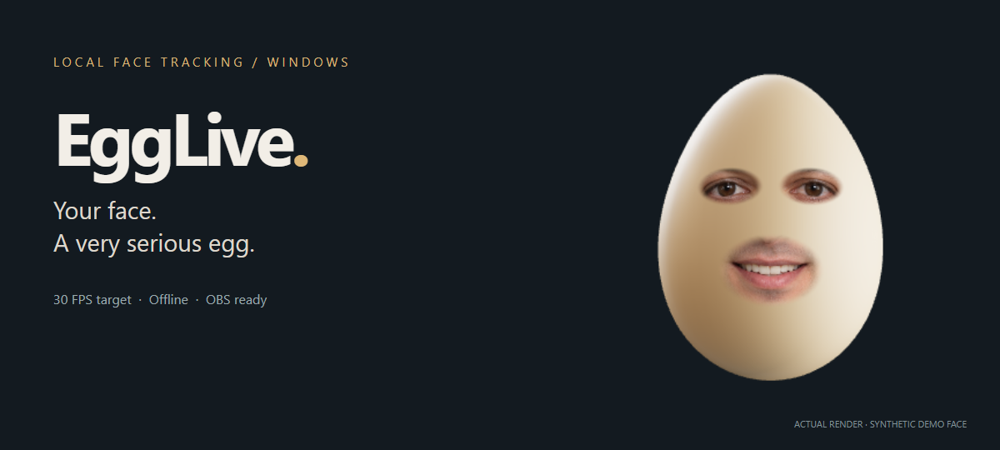
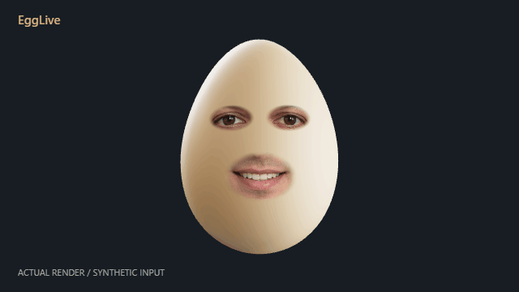

<div align="center">

# 🥚 EggLive

### Your face. A very serious egg.

**A webcam-powered 3D egg avatar for streaming, recording, and video calls.**

[](https://github.com/ShiroPpu69/EggLive/releases/latest)
[](LICENSE)
[](https://github.com/ShiroPpu69/EggLive/releases/latest)

**[Download for Windows](https://github.com/ShiroPpu69/EggLive/releases/latest) · [中文说明](README.zh-CN.md) · [OBS setup](docs/obs.md) · [Build from source](docs/building.md)**



</div>

Plug in a USB webcam. Blink, talk, and tilt your head. A realistic egg follows along, with your eyes and mouth blended into the shell and a little spring in its movement.

EggLive runs face tracking on your computer and sends a transparent avatar to OBS. The Windows installer includes the tracking model and an official OBS distribution, so viewers can get started without a development environment.

## See it move

<div align="center">



<sub>Actual EggLive rendering from an AI-generated fictional portrait. Motion is scripted for this illustration; this is not a live-webcam tracking accuracy demo.</sub>

</div>

## Small avatar, useful details

| | What you get |
|---|---|
| 🥚 **A convincing shell** | Curved 3D geometry, continuous procedural microtexture, physically based shading, and studio lighting. White and brown eggs included. |
| 👀 **Your own expressions** | Webcam eye and mouth crops follow MediaPipe's 478 face landmarks. Head movement drives the whole egg. |
| 🫧 **A little wobble** | Spring-and-damper motion, adjustable inertia, restrained squash, and smoothed head pose. |
| 🎥 **Ready for OBS** | One button prepares an OBS scene with transparent avatar output. OBS Virtual Camera makes it available to other video apps. |
| ⚡ **Built around 30 FPS** | Background tracking, paired frame/landmark sampling, interpolated rendering, and local hardware-accelerated video transport where supported. |
| 🔒 **Local processing** | Bundled offline tracking. Webcam frames and personal eye references stay on your computer. |
| 👓 **An option for strong lens glare** | Capture your uncovered open and closed eyes once, then drive the clean reference with live eyelid tracking. |

## Become an egg in three steps

1. **[Download the Windows x64 installer](https://github.com/ShiroPpu69/EggLive/releases/latest)** and install EggLive.
2. **Connect a USB webcam**, open EggLive, face the camera, and click **正脸校准** (Center pose).
3. Click **打开已配置的 OBS** (Open configured OBS). Add your microphone in OBS, then record or stream.

The current interface is in Chinese; the [OBS guide](docs/obs.md) includes English translations. Windows 10/11 x64 is the supported release target. Camera permissions may need to be enabled in Windows settings.

For video calls, use **安装虚拟摄像头** (Install virtual camera) once, approve the Windows system prompt, then select **OBS Virtual Camera** in the receiving app. Keep EggLive and OBS open.

## Glasses? Use a clean-eye reference

Live lens glare can obscure the eye completely. The ordinary glare slider reduces white/cyan/blue-purple highlights, but it cannot reliably recover an eye hidden by overexposure.

For stronger glare, the optional **无镜参考眼睛** mode uses your own clean reference:

1. Temporarily remove your glasses. Click **① 摘镜记录睁眼** and keep your eyes open for about four seconds.
2. Click **② 摘镜记录闭眼** and close both eyes for about four seconds.
3. After the enabled message appears, put your glasses back on. Your clean eye images now follow live eyelid opening; your mouth and head continue to track live.

**This is reference-driven animation, not AI recovery of the obscured live eye.** Gaze and subtle eye-area expressions are not fully reproduced. Glare can still reduce landmark accuracy. Capture without glasses, or the stored reference will contain the glare too. References are saved locally, can be deleted in the app, and must be captured separately on each computer.

## Performance, with the context attached

One development-machine measurement with a synthetic camera fixture and an OBS viewer:

| Metric | Observed |
|---|---|
| CPU | **~4.2%** of total system CPU for all EggLive processes |
| Test CPU | Ryzen 9 5900HX, 16 logical processors |
| Avatar render | ~29 FPS with a 30 FPS cap |
| Face tracking | ~15 FPS; display frames are interpolated |
| Video encode | ~30 FPS, hardware H.264 on the tested setup |
| Default avatar resolution | 640 × 360; OBS output 1280 × 720 |

This was a ~16-second sample, with reference-eye mode enabled. OBS, games, and stream recording/encoding are **not** included in the EggLive CPU figure. Results vary with hardware, drivers, camera format, quality settings, and other applications. See [validation and limitations](docs/validation.md).

## How it works

```text
USB webcam → paired image + face landmarks → 3D egg + spring motion
                          ↓
                local RGB + alpha WebRTC → OBS → stream / recording / virtual camera
```

The app snapshots a camera frame before inference and keeps that exact image paired with its landmarks. Eye and mouth crops therefore do not chase a newer webcam image while using older tracking results. Pose guards reject sudden outliers; brief detection gaps hold the last valid face before fading it out.

Only the avatar enters the OBS feed. RGB and alpha share a local video stream; the OBS browser source reconstructs transparency. The server listens on `127.0.0.1:18739`. OBS control uses an authenticated local WebSocket. See [architecture and privacy](docs/architecture.md).

## Run from source

For development on Windows, install Node.js 22.12+ and Git:

```powershell
git clone https://github.com/ShiroPpu69/EggLive.git
cd EggLive
npm ci
npm run setup
npm run build
npm start
```

The first asset setup needs internet access to download the pinned face model. Tracking then runs offline. To include automatic OBS setup:

```powershell
npm run setup -- --with-obs
```

See [building and packaging](docs/building.md) for the Windows installer, asset checksums, and third-party components. The distributed installer already contains the runtime assets; end users do not run these commands.

## Help make it a better egg

Useful contributions include an English UI, more webcam/driver coverage, improved tracking with glasses, lower-end GPU measurements, and better reference-eye animation. These are contribution ideas, **not shipped features**.

- [Report a reproducible bug](https://github.com/ShiroPpu69/EggLive/issues/new?template=bug_report.yml)
- [Suggest an improvement](https://github.com/ShiroPpu69/EggLive/issues/new?template=feature_request.yml)
- Read [CONTRIBUTING.md](CONTRIBUTING.md) before submitting code.

If the egg earns a spot in your stream, a **star** helps other creators find it. Sharing a clip is welcome—only post footage you have permission to share.

## Credits & license

EggLive's original application code is **[MIT licensed](LICENSE)**. Built with [MediaPipe](https://github.com/google-ai-edge/mediapipe), [Three.js](https://github.com/mrdoob/three.js), [Electron](https://github.com/electron/electron), and [ws](https://github.com/websockets/ws). Studio lighting: [Greg Zaal / Poly Haven](https://polyhaven.com/a/studio_small_03), CC0.

The Windows installer bundles unmodified official **OBS Studio 32.2.2**, a separately licensed GPL-2.0-or-later application. Its corresponding official source archive is provided with the release. Microsoft runtime components and other dependencies retain their respective terms. See [third-party notices](THIRD_PARTY_NOTICES.md).

This is an independent project, not an official TheBurntPeanut or Snapchat product. No proprietary creator avatar, Snapchat filter, or extracted commercial lens is included.
